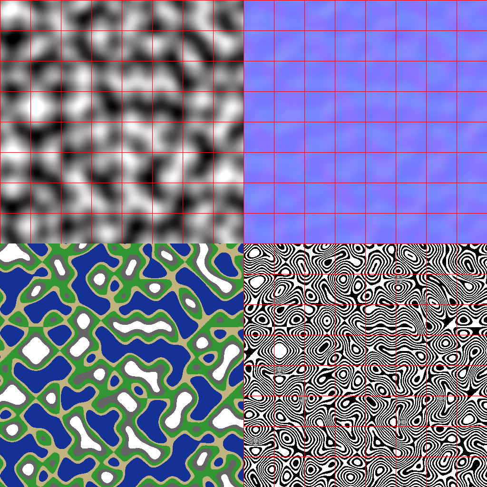

## Loading test 

is have no meaningful reults

but here is.

```python
[0.0 1.0 2.0 3.0 4.0 5.0 6.0 7.0 8.0 9.0]
```

## Result of batched generation

there is a png generated using pillow based on rust func result.


the red grid show tile generating (smt like chunks)


